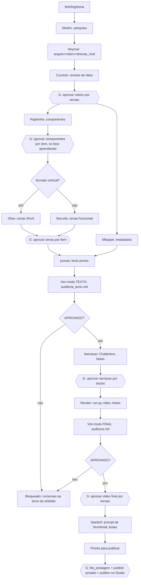
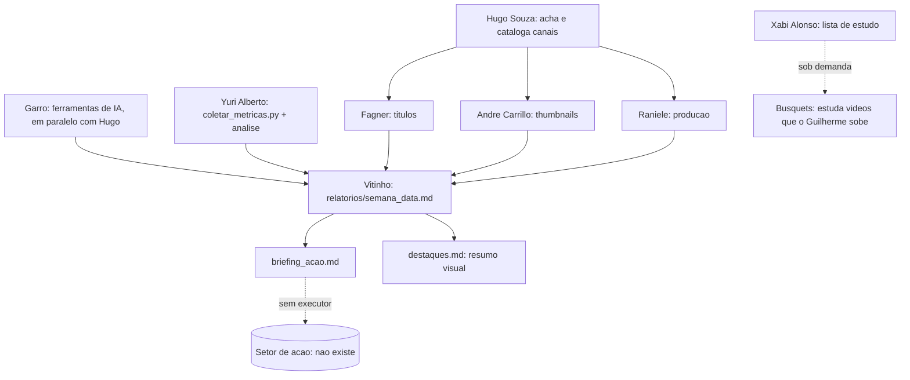
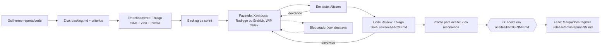
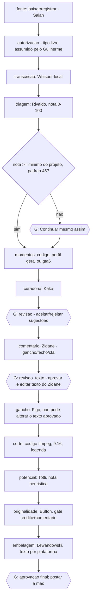
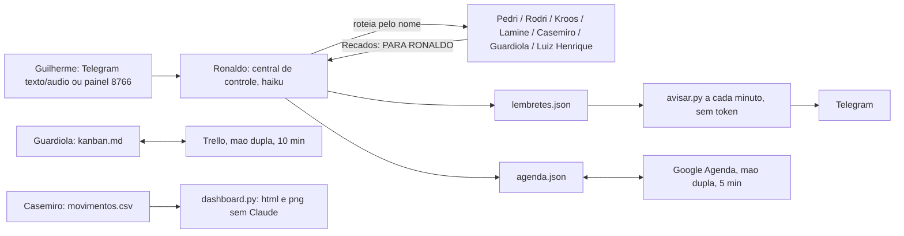

# Sistema único: fluxos, aprovações, acionamento e riscos (lado técnico)

Autor: **Valverde** (engenharia de IA). Data: 2026-11-11. Destino: **Firmino** (protótipo visual) e **Luiz Henrique** (mapa de setores, documento irmão `01_...`, não duplicado aqui).

Convenção: **[fato]** = lido em arquivo ou código neste repositório; **[dedução]** = conclusão minha, não confirmada em código; **[a decidir]** = depende do Guilherme. Números só quando medidos.

Fontes lidas: `CLAUDE.md`, `.claude/agents/` (56 arquivos, medido), `estudio/README.md` e código de `estudio/` (`servidor.py`, `fluxo.py`, `grafos.py`, `executor.py`, `agentes.py`, `central.py`, `painel.py`, `ao_vivo.py`, `acesso.py`, `config.py`), `inteligencia/README.md`, `programacao/README.md`, `produtividade/README.md` e `produtividade/painel.py`, `clipes/README.md` e `clipes/etapas.py`, `ecossistema/README.md` e `setores.json`, `config_shorts.yaml`, `run.py`, `postar_pendentes.py`, memória do projeto.

---

## 0. Resumo de arquitetura (o que o sistema único herda)

[fato] Já existem três servidores web locais, todos em Python de biblioteca padrão, escutando só em `127.0.0.1`:

| Servidor | Porta | Comando | Escopo |
|---|---|---|---|
| Corte (`estudio/`) | 8765 | `python -m corte` (ou `-m estudio`; `--rede` para o celular com senha) | produção do canal, editor de vídeo, agentes, fluxos, e ainda `/central` (programação) e `/painel` (leitura do ecossistema) |
| Painel do Ronaldo (`produtividade/painel.py`) | 8766 | `produtividade\painel.bat` | agenda, tarefas, finanças, clima, sprint, ordens a agentes |
| Painel de Clipes (`clipes/painel.py`) | 8767 | `python -m clipes painel` | fluxo de cortes de terceiros, com SSE ao vivo |

[fato] Estado: o Corte tem banco SQLite (`estudio/dados/estudio.db`, tabelas `producoes`, `versoes`, `aprovacoes`, `itens`, `feedback`, `jobs`, `eventos`, `fluxos`, `fluxo_versoes`, `execucoes`, `exec_nos`, `agente_versoes`, `dispensas_vini` etc.) e blobs por conteúdo. Os arquivos em `output/<slug>/` continuam a fonte da verdade; o banco guarda versões, aprovações e jobs. Clipes guarda em `clipes_out/<slug>/estado.json`. Ronaldo guarda em JSON/MD de `produtividade/`. Programação guarda em Markdown (`quadro.md`, `backlog.md`) espelhado no Trello.

[fato] Motor de agentes: todo agente de verdade é um processo `claude -p ...` (headless) disparado por `estudio/executor.py` (Corte), `produtividade/ronaldo_telegram.py` (Telegram e painel do Ronaldo) ou `clipes` (via Pelé). Não há fila central única entre os três: cada um tem a sua.

[dedução] O sistema único é, na prática, uma casca de navegação e um "barramento" sobre esses três backends. O caminho de menor risco é uma shell que reúne as telas e consome as APIs que já existem, sem reescrever o que o Corte já faz (aprovação por versão, jobs, grafo).

---

## 1. Fluxos de agentes por setor

Formato: cada fluxo traz (a) lista de nós e arestas para virar diagrama editável (Mermaid, colável em qualquer editor) e (b) tabela com o que cada nó lê/grava. Legenda: `[G]` = decisão do Guilherme; `||` = paralelo; `{?}` = condição.

### 1.1 Canal dark (Contexto Explica): produção de um Short

[fato] Fonte do desenho: `CLAUDE.md` (seção Fluxo), `estudio/grafos.py::grafo_real()` (fluxo padrão v1 do Corte) e `estudio/fluxo.py` (`ETAPAS`, `GATILHOS`, `DEPS`). O Corte e o `CLAUDE.md` concordam; o grafo do Corte é o formato editável.



| Nó | Agente / motor | Lê | Grava (em `output/<slug>/` salvo indicação) | Paralelismo e dependência |
|---|---|---|---|---|
| Pesquisa | **Modric** (`modric-pesquisador-tema`) | tema, `referencias_virais.md` do **Memphis** (se tiver até ~7 dias) | `notas.md` (3+ fontes) | dispara sozinho ao criar o projeto |
| Roteiro | **Neymar** | `notas.md`, `prompts/tipos_de_roteiro.md`, `output/messi_assinatura_canal.md` | `angulo.md`, `roteiro.txt`, `direcao_viral.md` | depende de Pesquisa; absorve ângulo e viral |
| Fatos | **Courtois** | `notas.md`, `roteiro.txt` | `revisao.md` | encadeado logo após o Neymar (`em_seguida` no `fluxo.py`) |
| Componentes | **Raphinha** (modelo `opus`, medido) | `componentes/aprendizados.md` (sempre primeiro), `componentes/catalogo.md`, `roteiro.txt`, `direcao_viral.md`, `estilo.json`, `media/estilos.py` | `componentes.md` + imagens | começa ao aprovar o roteiro; **em paralelo** com Mbappé |
| Metadados | **Mbappé** | roteiro aprovado | `metadados.json` | paralelo com Raphinha/Olise |
| Cenas | **Olise** (vertical) ou **Barcola** (horizontal) | `roteiro.txt`, `direcao_viral.md`, `componentes.md`, skills de estilo | `cenas.json`, `sketch_cenas.py` (só sketch), `previa.jpg` | depende de componentes aprovados |
| Auditoria de texto | **Vini** modo TEXTO | `roteiro.txt`, `notas.md`, `metadados.json`, textos de `cenas.json` | `auditoria_texto.md` (APROVADO/BLOQUEADO) | espera cenas **e** metadados (junção) |
| Narração | `python -m estudio.narrar` (código, sem agente) | `roteiro.txt`/`cenas.json`, `voz/amostra.wav` | trechos de áudio, `voz_ajustes.json` (opcional) | raia "pesado": 1 por vez; botão |
| Render | `python run.py video --topic ...` (código) | tudo acima | `video.mp4`, `audio.wav`, `eventos.json`, `thumbnail.jpg`, `PUBLICAR.txt`, `CONFORMIDADE.md`, `custo.json` | raia "pesado"; botão; depois dispara auditoria final |
| Auditoria final | **Vini** modo FINAL | `video.mp4`, metadados, thumbnail | `auditoria.md` (libera o `publish`) | automática após o render |
| Thumbnail | **Seedorf** | metadados, `roteiro.txt` | `prompt_thumbnail.txt` (não gera imagem) | botão (`auto: False`) |
| Publicação | `postar_pendentes.py` / `run.py publish` / Memphis | `output/fila_postagem.txt`, `auditoria.md` APROVADO, `thumbnail.jpg`, `metadados.json` | `upload.json`/`publicado.json` (privado) | um vídeo por execução; fora do Corte hoje |

Regras que o desenho **não pode** violar [fato, `CLAUDE.md`]:
- Nenhum render sem `auditoria_texto.md` APROVADO. Congelamento: depois da aprovação do **Vini**, `roteiro.txt` é imutável; depois do vídeo final, o pacote audiovisual fica congelado; só metadados podem bloquear a publicação.
- Orquestração por dependência: o **De Bruyne** dispara de uma vez tudo cujo insumo já existe. Em lote, cada slug corre em paralelo e só o render roda um por vez (no Corte: `LIMITE_RAIAS = {"agente": 3, "pesado": 1}`).
- Fluxo sob demanda (fora do diário): **Memphis** ~1x/semana (`referencias_virais.md`), **Haaland** (nicho), **Messi** e **Cristiano** (passes dedicados), **Kane** (narra vídeos soltos em `videos-kane/`, não usa `output/`).
- [fato, observação] Dois modelos de orquestração coexistem: o fluxo fixo de `fluxo.py` (produção antiga) e o grafo publicado (produções criadas com um fluxo, ou "Executar pelo fluxo"). O sistema único deve mostrar o grafo, mas continuar entendendo o estado do fluxo fixo.

### 1.2 Canal dark: variantes

- **Horizontal 16:9**: condição `se_vertical` troca **Olise** por **Barcola** (`--formato horizontal`, só estilo sketch). [fato]
- **Instagram/Reels** (**Dembelé**): mini-fluxo separado, sem `run.py` e sem agentes do canal: a squad escreve `cenas.json` + `prompt_imagens.txt`; o Guilherme gera imagens em outra IA e as salva em `reels/projetos/<slug>/imagens/`; depois monta o vídeo. [fato, `reels/README.md`]
- **Troca de estilo** em produção existente: tela lista o impacto; só reabrem os nós afetados; arquivos antigos vão a `_troca_estilo/<data>/`. [fato]

### 1.3 Setor de Inteligência

[fato] Contrato em `inteligencia/README.md`. Não há motor de ciclo: "hoje cada agente só roda quando é chamado". O **De Bruyne** é o chefe; a coordenação é por troca de arquivos. Escala 24 h: nada agendado.



| Nó | Grava | Observação |
|---|---|---|
| **Hugo Souza** | `canais/<canal>.md`, `canais/_indice.md`, `fontes.md` | pesquisa pontual, respeita robots.txt |
| **Garro** | `tecnologia/AAAA-MM-DD.md`, `tecnologia/ferramentas.md` | paralelo ao Hugo |
| **Fagner / André Carrillo / Raniele** | `titulos/`, `thumbnails/`, `producao/` | leem `canais/` |
| **Yuri Alberto** | `metricas/videos.csv` (via `coletar_metricas.py`, OAuth só leitura) | retenção/CTR exigem escopo `yt-analytics.readonly` (não concedido) |
| **Vitinho** | `relatorios/semana_<data>.md`, `briefing_acao.md`, `destaques.md` | fatos x hipóteses x lacunas |
| **Busquets / Xabi Alonso** | `aprendiz/AAAA-MM-DD/`, `referencias_estudo/`, `aprendiz/fila.md` | sob demanda; tetos US$ 0,30 e US$ 0,20, limite diário US$ 1,10 |

[dedução] Para o sistema único, "rodar ciclo de inteligência" é uma sequência manual de 5 a 7 chamadas `claude -p --agent`; o Corte hoje não tem grafo para isso. Pode ser modelado como um segundo fluxo publicado no editor de grafos (ver 3).

### 1.4 Setor de Programação (sprint)

[fato] `programacao/README.md`. Fonte única de trabalho: Trello "Kanban Trabalho" (espelho `produtividade/kanban.md`). Quem move cartão: só o maestro (`programacao/maestro.py`). **Maestro PAUSADO** desde 2026-11-05 por ordem do Guilherme; só religa se ele mandar (memória e `ecossistema/README.md`).



| Coluna | Dono | Grava (decisão em `programacao/maestro/decisoes/PROG-NNN.json` + arquivo próprio) |
|---|---|---|
| Backlog da sprint | **Xavi** | `quadro.md` (via maestro) |
| Refinamento | **Thiago Silva** (+ **Zico**, **Iniesta** se tela) | `tecnico/PROG-NNN.md`, `ux/PROG-NNN.md` |
| Fazendo | **Rodrygo** / **Endrick** | código + `entregas/PROG-NNN.md` |
| Em teste | **Alisson** | `qa/PROG-NNN.md` |
| Code Review | **Thiago Silva** | `revisoes/PROG-NNN.md` com `**Veredito: APROVADO.**` ou DEVOLVIDO |
| Pronto para aceite | **Zico** | recomendação; aceite é do Guilherme |
| Feito | **Marquinhos** | `release/notas-sprint-NN.md` |

Cadências [fato]: sprint de 1 semana, daily 10:30 (Xavi; o lembrete recorrente ainda não foi cadastrado pelo **Ronaldo**), review e retro no fim, refinamento contínuo.

[fato] O Corte já tem uma tela mínima desse setor em `/central` (`estudio/central.py`): lê `quadro.md` e `sprints/sprint-NN.md`, cruza com `jobs`; os botões "Rodar Daily" e "Abrir Planning" **só gravam um pedido** em `programacao/pedidos.jsonl`, não executam.

### 1.5 Setor de Clipes (Instagram/TikTok; separado do canal e do Corte)

[fato] `clipes/README.md`, `clipes/etapas.py` (`CATALOGO`). Fluxo configurável por projeto em `clipes_out/<slug>/fluxo.json`; cada etapa tem executor `codigo`, `agente` ou `humano`.



Orquestrador: **Pelé**; `clipes/orquestrador.py` marca `espera_voce` nos nós humanos. Estado em tempo real via SSE (`/api/eventos`). O **Pirlo** (`pesquisa_videos/`) lista vídeos longos populares como fonte de entrada. No `--rede` o painel de clipes é **só leitura**. [fato]

### 1.6 Setor de Produtividade profissional + Finanças

[fato] `produtividade/README.md`, `financas/README.md`. Responsável: **Luiz Henrique**; chefe: **Guardiola**.



| Agente | Escreve em | Modelo |
|---|---|---|
| **Ronaldo** | `agenda.json`, `agenda.md`, `lembretes.json` (único que escreve em `lembretes.json`) | haiku |
| **Guardiola** | `kanban.md` | sonnet |
| **Pedri / Rodri / Kroos** | `tarefas.md` / `horas.md` / `acessos.md` | haiku |
| **Lamine Yamal** | `linkedin/rascunhos.md` | sonnet |
| **Bellingham** | `dicas_ios/dicas.md` (uso raro; nunca recebe código ou dado do trabalho) | (não medido) |
| **Casemiro** | `financas/movimentos.csv`, `saldos.csv`, `pendencias.md` | sonnet |

[fato] Só o **Ronaldo** fala com o Guilherme no Telegram. **De Bruyne** pelo Telegram roda em segundo plano (teto US$ 3,00 por pedido, sem publicar nem gastar) e envia o vídeo pronto.

### 1.7 Fluxo transversal: ecossistema e engenharia de IA

[fato] **Luiz Henrique** cria/altera agentes e setores e mantém `ecossistema/README.md` e `ecossistema/setores.json` (fonte única lida por `estudio/painel.py` e `estudio/central.py`); roda `tools/sincronizar_codex.py` ao mudar agente. **Valverde** só diagnostica e propõe (escreve em `ecossistema/engenharia-ia/`). **Firmino** (`firmino-frontend-design`) é atalho da skill `frontend-design`. [fato] Um hook `PostToolUse` (`tools/hook_espelho.py`) regenera `espelho_sistema.html` quando um agente cria/altera `.md`/`.txt`.

---

## 2. Pontos de decisão do Guilherme (e o que mostrar para decidir em um clique)

Princípio: a tela de decisão mostra **o artefato, o que muda se aprovar, o custo e o botão**. Nunca pergunta "posso continuar?" onde o `CLAUDE.md` diz para decidir o rotineiro (seção Autonomia). Os itens abaixo são só os que são do Guilherme por regra.

### 2.1 Canal dark

| # | Decisão | Origem | O que mostrar na tela | Ação |
|---|---|---|---|---|
| C1 | **Aprovar roteiro** (por versão) | [fato] Corte, gate `versao`; `CLAUDE.md` (congelamento) | texto de `roteiro.txt`, tipo de roteiro (e se repete os últimos 3), nº de números/gráficos (`media/roteiro.py`), parecer do **Courtois** (`revisao.md`), diff contra a versão anterior | Aprovar / Pedir ajuste (categoria: Texto, Fato, Gancho, Ritmo) |
| C2 | **Aprovar componentes** por item (fase "aprendendo") | [fato] `componentes/aprendizados.md` linha 1 = `Fase: aprendendo`; `grafos.py:618` dispensa a validação fora dessa fase | imagem do componente, regra de layout proposta, a regra nova que seria gravada em `aprendizados.md` | Aprovar item / Corrigir (vira regra permanente) / "Pronto, qualidade atingida" (muda a fase: [a decidir] quem grava) |
| C3 | **Aprovar cenas** por item | [fato] gate `itens`, recorte da `previa.jpg` | miniatura da cena + fala + texto na tela | Aprovar / Ajustar (Desenho, Texto na tela, Animação) |
| C4 | **Estilo e troca de estilo** | [fato] decisão do dono (sketch padrão); troca exige confirmação da lista de impacto | lista exata do que será refeito (o servidor só aceita a confirmação daquela lista) | Confirmar |
| C5 | **Parecer do Vini bloqueando o texto** | [fato] `resolver_parecer`, `pular_vini` (dispensa registrada por hash) | correções obrigatórias por dono (roteiro, cenas, metadados); risco declarado se dispensar | Encaminhar correções / Dispensar escopo (registra "APROVADO COM DISPENSA DO GUILHERME") |
| C6 | **Iniciar narração** e **iniciar render** | [fato] "Narração e render sempre têm botão próprio" | duração estimada (dedução: a CPU do Chatterbox é pesada, tempo não medido aqui), aviso de que o render é um por vez | Botão |
| C7 | **Aprovar narração** por trecho | [fato] gate `itens` | player por trecho + pronúncia; opção `voz_ajustes.json` | Aprovar / Ajustar (Pronúncia, Ritmo, Entonação) |
| C8 | **Aprovar vídeo final** por versão | [fato] libera o download (`/download/<slug>` só serve versão aprovada) | player, parecer do **Vini** FINAL, `CONFORMIDADE.md` | Aprovar / Pedir ajuste (Imagem, Som, Narração, Texto) |
| C9 | **Nova versão do vídeo depois do congelamento** | [fato] regra inviolável: só o Guilherme autoriza explicitamente | texto de aviso: "Congelado. Autorizar nova versão?" com motivo | Autorizar (confirmação dupla) |
| C10 | **Thumbnail** | [fato] Seedorf só gera prompt; imagem é feita fora (ChatGPT) | prompt para copiar; área de upload (`/enviar/thumbnail`), prévia | Copiar prompt / Enviar imagem / Aprovar (`decidir_thumbnail`) |
| C11 | **Publicar** | [fato] `postar_pendentes.py` (um por execução, PRIVADO), `run.py publish`; público só no Studio, manual; Memphis é o responsável | checklist: `auditoria.md` APROVADO, `thumbnail.jpg`, `metadados.json`, posição na fila, data sugerida (`/api/cronograma`) | "Enfileirar" (edita `fila_postagem.txt`) e "Subir como privado" com confirmação externa explícita; marcar público (`publico.json`) |
| C12 | **Novo projeto e tema** | [fato] Corte | lista de temas do **Modric** ainda sem vídeo (`/api/temas`); "Gerar um tema" aciona o **Modric** de verdade (custa uso do plano) | Escolher / Gerar |
| C13 | **Gasto pago (`--allow-paid`)** | [fato] `budget.max_usd_per_video: 0`; o Corte **não oferece** `--allow-paid` | só aparece se o Guilherme criar a opção; custo previsto e teto | [a decidir]; padrão: nunca mostrar |
| C14 | **Memphis (~1x/semana)** | [fato] sob demanda | idade de `referencias_virais.md` e botão | Rodar |
| C15 | **Exportar do editor** | [fato] `corte_exportar` com `confirmado` | aviso: "vira nova versão do vídeo final; o **Vini** audita de novo" | Confirmar |
| C16 | **Teste de agente** (tela Agentes) | [fato] teto US$ 1,00 | custo máximo | Rodar |

### 2.2 Clipes

| # | Decisão | Origem | Mostrar | Ação |
|---|---|---|---|---|
| L1 | **Continuar mesmo assim** (nota da triagem abaixo do mínimo) | [fato] `triagem` = `espera_voce` | nota, motivos, riscos, momentos promissores do **Rivaldo** | Continuar / Descartar fonte |
| L2 | **Aceitar/rejeitar sugestões** (`revisao`) | [fato] | cada momento: trecho, nota, `motivo`, `contexto_necessario`, problemas | aceitar / rejeitar por momento |
| L3 | **Aprovar e editar o texto do Zidane** (`revisao_texto`) | [fato] decisão de 2026-11-11 (memória `clipes-aprovar-texto-zidane`): gancho/fecho/cta só seguem após aprovação; o texto editado vale como está e o **Figo** não pode alterar | campos editáveis gancho, fecho, cta | Aprovar texto / Reescrever |
| L4 | **Autorização da fonte** | [fato] decisão de 2026-11-10: tipo `livre` assume o risco | aviso fixo de que o risco é dele e fica registrado | Escolher tipo |
| L5 | **Aprovação final e postagem manual** | [fato] "Nunca publica" | corte, textos Instagram/TikTok, crédito, `check` do **Buffon** | Aprovar; postar à mão |

### 2.3 Programação

| # | Decisão | Origem | Mostrar | Ação |
|---|---|---|---|---|
| P1 | **Aceite de PROG-NNN** | [fato] sem `aceites/PROG-NNN.md` o maestro não move para Feito | critérios, evidência de `qa/` e `revisoes/`, recomendação do **Zico** | Aceitar (grava o arquivo) / Recusar |
| P2 | **Religar o maestro / abrir sprint** | [fato] pausado até ordem explícita | estado da tarefa `ContextoExplica-Sprint` (verificar no agendador antes de afirmar) | Religar (confirmação) |
| P3 | **Commit** | [fato] só quando ele pedir | `git status` resumido | Botão com confirmação |
| P4 | **"Faz já, fora do quadro"** | [fato] única exceção à regra do quadro | campo de texto | Enviar ao **Zico** |
| P5 | **Trello** | [fato] "o que ele muda no Trello vale e nenhum agente desfaz"; todo avanço vai ao Trello na hora; nunca apagar checklist | cartões e colunas lidos de `programacao/quadro.md`/`kanban.md` | UI nunca sobrescreve Trello; qualquer escrita passa por `trello_sync.py` / `kanban_programacao.py` |
| P6 | **Mudança nas cadências** (planning, daily 10:30 e dias) | [fato] pendente | dias e hora | Confirmar |

### 2.4 Produtividade, finanças e ecossistema

| # | Decisão | Origem | Mostrar | Ação |
|---|---|---|---|---|
| A1 | **Ação sensível** (qualquer coisa externa: enviar convite, mensagem, lançar horas, publicar LinkedIn, trocar senha) | [fato] agentes preparam, ele executa | rascunho pronto e destino | "Confirmo" (o sistema nunca envia por conta própria) |
| A2 | **Marcar conta como paga** | [fato] **Casemiro**: só com confirmação dele | conta, valor, vencimento | Confirmar |
| A3 | **Reconectar Google Agenda** | [fato] app em modo "Testando", autorização vence a cada 7 dias | aviso e comando `python produtividade/google_pessoal.py` | Botão que abre instrução (OAuth é no navegador) |
| A4 | **Escopo OAuth `yt-analytics.readonly`** (retenção e CTR) | [fato] pendência do setor de inteligência | o que ganha e o que muda no consentimento | [a decidir] |
| A5 | **Agendar ciclos 24 h da Inteligência** | [fato] não agendado; duas opções registradas (rotinas agendadas com custo de token, ou ciclo manual) | custo estimado por execução [dedução: não medido] | [a decidir] |
| A6 | **Criar/alterar agente ou setor** | [fato] **Luiz Henrique** cria; o texto de agente de outro só é alterado depois de aprovado | diff, versão, o que passa a usar | Aprovar |
| A7 | **Codex como reserva** | [fato] só quando o Claude esgota limite; nunca antes | selo do motor por job (já existe: `motor`, `motor_nota`) | informativo |
| A8 | **Tetos de custo** (Busquets US$ 0,30, Xabi Alonso US$ 0,20, diário US$ 1,10; De Bruyne US$ 3,00; mensagem comum US$ 0,30) | [fato] | consumo acumulado (`.ronaldo_custo.jsonl`, `custo.json`) | Alterar teto [a decidir] |
| A9 | **Cadastrar o lembrete da daily 10:30** | [fato] pendente com o **Ronaldo** | | Confirmar dias da semana |
| A10 | **Acessos, senhas e tokens** | [fato] nunca guardados pelo sistema | | A UI nunca pede nem exibe segredo |

### 2.5 Fila única "Espera você" (sugestão de tela)

[fato] O Corte já tem o conceito: `GET /api/agentes/ao-vivo` devolve `espera_voce` por agente (cache de 3 s); Clipes marca `espera_voce` por nó; o painel de Ronaldo mostra pendências. [dedução] O sistema único deve ter **uma caixa de entrada** que junta: C1 a C16, L1 a L5, P1/P2, A1 a A3, ordenada por urgência e por dependência (o que está travando fluxo vem antes), cada linha com os botões da coluna "Ação". Decisão sempre presa a versão/hash (já é assim no Corte: aprovação vale só para aquela versão).

---

## 3. Interfaces existentes: reaproveitar, adaptar, substituir

### 3.1 Inventário [fato, salvo marcação]

| Interface | Onde | Estado | Para o sistema único |
|---|---|---|---|
| Corte: Projetos, Estúdio, Revisão, Editor, Agentes, Fluxos | `http://127.0.0.1:8765/`, `estudio/web/*.js`, `corte.css` | completa, testada (e2e em Chrome real), responsiva até 820 px, acesso por celular com senha | **Reaproveitar** o back-end e as regras; a casca visual é o que o **Firmino** redesenha. Substituir só o CSS e a navegação, não a lógica de aprovação por versão |
| Corte `/central` | `estudio/central.py`, `central.html` | MVP da programação; botões só gravam `pedidos.jsonl` | **Substituir** pela visão de setores e quadro do sistema único; manter `central.quadro()`/`sprint_ativa()` como fonte |
| Corte `/painel` (Ecossistema) | `estudio/painel.py`, `painel.html`; `/api/painel/{visao,documentos,documento,mudancas,resumo,setores}` | só leitura; lista de permissão, bloqueia segredos; documento só sai se estiver no índice | **Reaproveitar tal como está** para "documentos e mudanças"; é a fonte do explorador de arquivos |
| Painel do Ronaldo | `produtividade/painel.py` (8766); `/api/estado`, `/api/resumo`, POST `/api/feito`, `/api/adicionar`, `/api/ordem` | funcional; visual "AETHER" (fundo escuro, ciano, esfera) | **Reaproveitar** a lógica (cartões, ordens, clima); **substituir** o servidor separado por um módulo do servidor único (dedução: duas portas e dois `Host`-checks são manutenção dobrada). Manter o visual como tema, pois é decisão estética do Guilherme |
| Painel de Clipes | `clipes/painel.py` (8767), `clipes/web/index.html`; `/api/eventos` (SSE), `/api/iniciar`, `/api/ajustar/<slug>/<N>` | funcional, SSE | **Reaproveitar** (embutir ou unificar); manter regra "no `--rede` só leitura" |
| `espelho_sistema.html` | gerado por `tools/gerar_espelho.py` + hook | é onde o Guilherme lê os documentos | substituir por `/painel` (mesma fonte); manter o hook se ele ainda quiser o HTML estático |
| `pipeline_visual.html`, `ecossistema/dashboard-setores.html`, `financas/dashboard.html/png` | arquivos estáticos | vários dashboards soltos | [dedução] fundir no sistema único; `financas/dashboard.py` continua gerando dados sem token |
| Trello, Google Agenda, Telegram (`@ronaldo_r9_assistente_bot`) | serviços externos | ativos | **Manter** como estão; o sistema único é leitor, não substituto (o Guilherme usa Trello no celular) |
| Terminal com log ao vivo | memória `acompanhar-tarefas-longas-ao-vivo` | prática, não UI | substituir por painel de job (`/api/jobs/<id>/log`) |

### 3.2 Fontes de dados por tela (endpoints e arquivos)

[fato] Rotas do Corte (`estudio/servidor.py`):

- Produção: `GET /api/producoes` (lista por grupos + integrações), `GET /api/producoes/<slug>` (estado: etapas, `execucao`, bloqueios), `/estudio`, `/corte`, `/material/<tipo>`, `/detalhes`, `/estilo`, `/tomadas`, `/thumbnail`; `GET /api/videos/status` (status derivado de `output/<slug>/` e `fila_postagem.txt`, só leitura); `GET /api/cronograma`; `GET /api/temas`; `GET /api/opcoes`.
- Decisão: `POST /api/producoes/<slug>/{aprovar,item,feedback,enviar_ajustes,resolver_parecer,pular_vini,iniciar,executar,editar_roteiro,editar_cena,editar_metadados,decidir_thumbnail,corte_*}`; `POST /api/execucoes/<id>/{aprovar,liberar,repetir,devolver}`; `POST /api/jobs/<id>/{tentar,cancelar,dispensar}`; upload `POST /api/producoes/<slug>/enviar/{asset,componente,thumbnail}` (máx. 30 MB).
- Agentes: `GET /api/agentes` (catálogo + opções), `GET /api/agentes/ao-vivo`, `/api/agentes/<id>`, `/comparar`, `/versao/<n>`; `POST /api/agentes/<id>/{salvar,duplicar,ativar,restaurar,testar}`.
- Fluxos: `GET /api/fluxos`, `/api/fluxos/<id>`; `POST /api/fluxos/<id>/{salvar,publicar,ensaiar,impacto,restaurar}`.
- Programação: `GET /api/sprints/ativa`, `/api/central/quadro`, `/api/agentes/status`, `/api/central/agentes/<id>`; `POST /api/central/acao/<tipo>`.
- Ecossistema: `GET /api/painel/*` (ver 3.1), `GET /api/central/setores`.
- Mídia: `/quadro/<sha>`, `/blob/<sha>`, `/download/<slug>` (só versão aprovada), `/web/*`.

[fato] Arquivos que servem de fonte sem back-end novo:

| Dado | Arquivo |
|---|---|
| Setores e agentes (fonte única) | `ecossistema/setores.json` |
| Cadastro de agentes (nome, descrição, tools, modelo) | `.claude/agents/*.md` (frontmatter) |
| Contrato do canal | `CLAUDE.md`, `output/messi_assinatura_canal.md` |
| Config do canal | `config_shorts.yaml`, `config_horizontal.yaml` |
| Fila e status de publicação | `output/fila_postagem.txt`, `output/<slug>/auditoria*.md`, `upload.json`, `publico.json` |
| Custo do vídeo | `output/<slug>/custo.json` |
| Aprendizado do Raphinha | `componentes/aprendizados.md`, `componentes/catalogo.md` |
| Inteligência | `inteligencia/{destaques,briefing_acao}.md`, `relatorios/`, `metricas/videos.csv` |
| Programação | `programacao/{quadro,backlog}.md`, `sprints/`, `aceites/`, `qa/`, `revisoes/`, `entregas/`, `maestro/decisoes/*.json`, `pedidos.jsonl`, `pausas.json` |
| Produtividade | `produtividade/{agenda.json,lembretes.json,tarefas.md,horas.md,kanban.md,acessos.md}` |
| Finanças | `financas/{movimentos.csv,saldos.csv,pendencias.md}` |
| Clipes | `clipes_out/<slug>/estado.json`, `fluxo.json`, `momentos.json`, `triagem.json`, `perfil.json`; `clipes/perfis/*.json` |
| Custo do Ronaldo | `produtividade/.ronaldo_custo.jsonl` (gitignored) |

[fato] Lacunas de dado: (a) **a publicação não está no Corte** (README: "Publicar continua fora do estúdio"), então não há endpoint para enfileirar ou subir; (b) o cronograma não tem tela (README: "depende do desenho do Iniesta"); (c) não há API de Inteligência, de Finanças nem de Trello no Corte; (d) o `/api/central/agentes/<id>` casa agentes só pelo primeiro nome do id (`ident.split("-")[0]`), o que [dedução] erra para nomes compostos (`thiago-silva` casa com "thiago" no campo craque).

---

## 4. Como acionar agentes e comandos sem o VS Code

### 4.1 O que é viável hoje [fato]

| Mecanismo | Como funciona | Já usado por |
|---|---|---|
| Servidor local + `claude -p` headless | `claude -p --agent <id> --permission-mode acceptEdits --allowedTools "<lista>" --strict-mcp-config --no-session-persistence --max-budget-usd <teto> --output-format stream-json --verbose`, prompt por `stdin`, `cwd` na raiz; o executor roda **destacado do servidor** (`estudio/executor.py`), com `spec.json`, `log.txt`, `batimento`, `resultado.json` por job em `estudio/dados/jobs/<id>/` | Corte, Telegram, painel do Ronaldo |
| Agente "preso" a uma versão | `--system-prompt-file` com a foto do agente (`agente_sistema.md`), `--tools`, `--model` | execuções por fluxo e testes |
| Comandos de produção | `python run.py video`, `python -m estudio.narrar`, `python -m media.sketch`, `python run.py publish`, `python postar_pendentes.py` rodados pelo executor (raia "pesado") | Corte |
| Sem chave paga | o executor tira todas as variáveis do `.env` do ambiente do agente; usa o login do Claude Code, nunca a `ANTHROPIC_API_KEY` | Corte (`ambiente_agente`) |
| Telegram | `produtividade/ronaldo_telegram.py` (long polling, só o chat do Guilherme, áudio transcrito localmente com faster-whisper `small`), roteia pelo nome; **De Bruyne** em segundo plano; comandos sem custo `/hoje`, `/dashboard`, `/ajuda` | Ronaldo |
| Agendador do Windows | `ContextoExplica-Avisos` (1 min), `-Ronaldo` (5 min), `-Trello` (10 min), `-GoogleAgenda` (5 min), `-Sprint` (desligada) | produtividade |
| Reserva Codex | `codex exec` quando o Claude responde com texto de limite (`reserva.e_limite_do_claude`); refeito uma vez | Corte |
| Acesso celular | `--rede` com senha, só rede privada, HTTP | Corte |

[fato] Ordens de dois painéis diferentes (Corte e Ronaldo) usam **dois roteamentos** de agente: o Corte, via `executor`; o Ronaldo, via `ronaldo_telegram.py` (dicionário `AGENTES`, com modelo e pasta permitida por agente). O sistema único precisa escolher um (ver 4.3).

### 4.2 Limitações reais

1. [fato] O Claude Code precisa estar **instalado e logado** na máquina (`claude auth status` é verificado em `trabalhos.integracoes()`). Sem login, nada de agente roda.
2. [fato] O computador precisa estar **ligado e sem suspender** (Telegram, avisos, agendador, painéis). Fora de casa, o Corte **não** é acessível (sem Tailscale ou equivalente); só o Telegram funciona de fora.
3. [fato] Limites do plano do Claude (5 horas, semanal): o Corte reserva com Codex só nesses casos. Interativo (conversa do Claude Code) não troca sozinho.
4. [dedução] Um `claude -p` não conversa com o Guilherme no meio da execução: se o agente precisa perguntar, ele termina a rodada. Por isso toda pergunta precisa virar um estado "espera você" gravado em arquivo (é o que o Corte e o Clipes já fazem) e uma nova rodada com a resposta. O sistema único não deve prometer "chat ao vivo com o agente" sobre `-p`; para isso seria preciso o Agent SDK ou `--input-format stream-json` [dedução: não testado aqui].
5. [fato] `--strict-mcp-config` desliga MCPs nesses jobs: conectores do claude.ai (Taplio/LinkedIn, ElevenLabs etc.) **não** estão disponíveis para os agentes headless. Qualquer integração externa tem de ser por script local ou por API chamada pelo servidor.
6. [fato] Tempo-limite por agente: 45 min (`TEMPO_AGENTE_S`), pesado 90 min. Máximo de 3 agentes juntos e 1 render/narração por vez; clique duplo não duplica (o banco recusa dois trabalhos ativos na mesma etapa).
7. [fato] Permissões: o `claude -p` do Corte usa `acceptEdits` e uma lista fixa de ferramentas (`Agent,Read,Write,Edit,Glob,Grep,WebSearch,WebFetch,Bash(python run.py *),Bash(python -m media.sketch *),Bash(ls *),Bash(dir *)`). Agentes do Telegram têm edição só na pasta própria. O `settings.local.json` da sessão interativa usa `bypassPermissions`; [dedução] o sistema único **não** deve herdar isso.
8. [fato] Windows específico: `creationflags` (`CREATE_NO_WINDOW`), `taskkill`, agendador. Qualquer porte para outro SO exige trabalho.
9. [fato] Publicação no YouTube exige `client_secret.json` + `.youtube_token.json` (gitignored) e consentimento OAuth no navegador; app Google em modo "Testando" vence em 7 dias.
10. [fato] Render e voz são pesados em CPU (Chatterbox local; "alguns minutos de CPU" nos testes). Um render por vez evita travar a máquina.
11. [fato] Segredos: ficam só no `.env`; `estudio/painel.py` bloqueia documentos que pareçam credencial. O sistema único nunca deve exibir, editar ou gravar `.env`, `client_secret*` ou tokens.
12. [dedução] Um único servidor com SQLite em WAL aguenta bem o uso de uma pessoa; vários processos escrevendo (Corte, Clipes, Telegram, painéis) em arquivos JSON/MD é o ponto frágil: hoje ninguém usa lock entre eles além de regras de pasta.

### 4.3 Arquitetura de acionamento recomendada [dedução]

```
Navegador (sistema unico, localhost; celular via --rede)
   |
   v
Servidor unico (extensao do Corte, 8765)  -- le arquivos/DB, valida, grava versao
   |-- Executor existente (claude -p, comandos pesados, jobs com log e batimento)
   |-- Adaptadores de leitura: Clipes (estado.json/SSE), Ronaldo (json/md), Programacao (md/Trello)
   |-- Telegram (continua sendo o canal fora de casa; Ronaldo e o unico que fala)
```

Regras:
- Um único registro de jobs (o `jobs` do Corte) para todos os setores; Clipes e Ronaldo passam a registrar lá ao invés de manter filas próprias. [dedução] Isso permite uma só tela "Ao vivo".
- Botão que **gasta** (agente ou render) diz antes o que dispara, teto e motor; abrir uma tela nunca dispara agente (regra já existente).
- Ações externas (publicar, enviar, lançar horas, Trello) passam por uma **rampa de confirmação** própria, nunca pelo mesmo botão de "executar".

---

## 5. O que o Guilherme pode editar pela UI e como salvar com segurança

### 5.1 O que já existe [fato]

| Objeto | Onde | Salvar | Proteções |
|---|---|---|---|
| Agente (`.claude/agents/<id>.md`) | tela Agentes | `agentes.salvar` | valida descrição (>= 5 caracteres), instruções não vazias, só ferramentas/modelos que já existem (`Bash(...)` novo não entra), contrato `entradas:`/`saidas:`; `versao_vista` impede sobrescrever mudança feita por fora ("O agente mudou por fora... Recarregue"); histórico em `agente_versoes` com `restaurar`/`comparar`; escrita atômica (`.tmp` + `replace`), preserva CRLF/BOM; renomear é recusado se o agente está em uso em algum fluxo; desativar move para `.claude/agents_desativados/`; testar roda num diretório isolado, teto US$ 1,00 |
| Fluxo (grafo) | tela Fluxos | `salvar_rascunho` (rascunho) e `publicar` | `validar` devolve `erro`/`aviso` por nó e aresta, publicar é recusado com erros; versões numeradas; `ensaiar` percorre o grafo contra um projeto **sem acionar agente**; `impacto_desativar`; `restaurar_rascunho`; execução em andamento guarda foto do grafo e dos agentes, e `migrar_execucao` é passo explícito |
| Roteiro, cenas, metadados | revisão | `editar_roteiro/cena/metadados` | cada edição vira versão e invalida o que dependia (`DEPS`); [fato] nenhum agente nem usuário altera `roteiro.txt` depois da aprovação do **Vini** sem nova autorização (C9) |
| Edição de vídeo | Editor | `corte_salvar`, `corte_versao`, `corte_restaurar` com `rev` (concorrência otimista) | conflitos mostram o que mudou |
| Lembretes, tarefas, compromissos | painel do Ronaldo | JSON direto, `origem: "Painel"` | validação de data/hora; backup restaurado se JSON ficar inválido (no Telegram); `X-Painel` obrigatório |

### 5.2 O que falta e como fazer (proposta) [dedução]

| Item | Hoje | Proposta |
|---|---|---|
| `CLAUDE.md` | só o Guilherme edita | Editor em modo **seções** (Formato, Regras do canal, Fluxo, Autonomia...) com diff, e aviso fixo nas regras inegociáveis (políticas do YouTube e monetização, tom com vítimas, fatos só de notas com 3+ fontes, congelamento, ação externa só com confirmação): salvar nelas exige digitar "confirmo" e grava o motivo. É contrato lido por todos os agentes, então qualquer edição também muda o custo de todos os `claude -p` [dedução: o arquivo tem 18.952 caracteres medidos e, em projeto, o Claude Code o carrega no contexto] |
| `config_shorts.yaml` e `config_horizontal.yaml` | arquivo | Formulário por seção (`budget`, `publish`, `voz`, `render`, `compliance`, `cronograma`). Validar com `yaml.safe_load` e esquema (tipos, faixas: `fps`, `duracao_*`, `max_usd_per_video >= 0`, `publish.privacy` ∈ {private, unlisted, public}). **Travar** `budget.max_usd_per_video` e `publish.privacy: public` atrás de confirmação. Gravar só as chaves alteradas, preservando comentários (usar edição textual por chave ou `ruamel.yaml`; o `yaml.safe_dump` perde os comentários do arquivo) |
| Cadência de postagem | `config_shorts.yaml` seção `cronograma` (hoje comentada; sem ela: 1 vídeo por dia às 18:00) e `compliance.max_videos_per_day: 2` | Formulário "dias da semana + hora"; mostrar o efeito pela prévia de `/api/cronograma`; avisar se passar de `max_videos_per_day` |
| Cadências de rotina (daily 10:30, resumo 08:30, avisos) | `lembretes.json` (só o **Ronaldo** escreve) e agendador do Windows | Editar só o `lembretes.json`, pelo mesmo caminho do painel do Ronaldo. **Não** mexer em tarefas do agendador pela UI (exige `schtasks`/privilégio); mostrar o estado e o comando para copiar |
| Prompts e skills (`prompts/`, `.claude/skills/`) | arquivo | Mesmo mecanismo de versão do agente (ver abaixo) |
| `componentes/aprendizados.md` (fase "aprendendo" → "pronto") | arquivo, linha 1 | Botão "Pronto" com confirmação; grava a linha e um log |
| `ecossistema/setores.json` | **Luiz Henrique** | Edição só para mover agente de setor; validar que todo id existe em `.claude/agents` e não está duplicado (hoje agente fora do arquivo aparece como "Sem setor") |

Mecanismo comum de salvamento [dedução, estendendo o que `agentes.py` já faz]:
1. **Ler com hash** (sha do conteúdo) e mandá-lo à tela; na gravação, recusar se o hash mudou ("mudou por fora, recarregue").
2. **Validar antes** (estrutura, tipos, faixas, ids existentes, grafo sem erro) e mostrar a lista de erros em português.
3. **Mostrar diff** antes de gravar; para arquivos de regra, listar o que mudaria no comportamento (quais agentes leem aquilo).
4. **Gravar atômico** (`.tmp` + `replace`), preservando fim de linha e BOM.
5. **Versionar** (tabela de versões com quem, quando, nota) e oferecer **desfazer** (restaurar versão = grava uma nova versão igual à antiga, não apaga histórico).
6. **Pós-efeitos**: ao salvar agente, rodar `python tools/sincronizar_codex.py` (espelho `.codex/agents`) [fato: é a regra de **Luiz Henrique**]; o hook de espelho regenera `espelho_sistema.html` sozinho.
7. **Não alterar o que está em execução**: execução de grafo usa foto; edição vale para as próximas. O texto "vale para os próximos jobs" deve aparecer ao salvar.
8. **Registro de aplicação**: [fato] para texto de agente o aplicador é **Luiz Henrique**, depois de aprovado pelo Guilherme. [dedução] Quando o Guilherme edita pela UI ele é, ele mesmo, a aprovação; já proposta de **Valverde** continua passando por aprovação antes de gravar. A tela de Propostas (`ecossistema/engenharia-ia/propostas.md`) pode ter "Aplicar" que abre o editor já com o texto sugerido, em vez de gravar direto.
9. **Segredos**: campos que casem com o padrão de `CREDENCIAL` (`estudio/painel.py`) são recusados na gravação.

[a decidir] Se o Guilherme quer um modo "sem confirmação" para edições de baixo risco (cadência, descrição de agente) e confirmação obrigatória nas de alto risco (regras do YouTube, `publish.privacy`, `budget`, `CLAUDE.md`).

---

## 6. Riscos e desperdícios de token a evitar

### 6.1 Riscos do sistema único

1. **Segredo exposto.** O painel lê quase tudo e o Guilherme pediu transparência total (memória `painel-transparencia-total`). Manter a lista de permissão e a varredura de credencial de `estudio/painel.py`; nunca ler `.env`, `client_secret*`, `.youtube_token.json`, `senha_rede.txt`, `.ronaldo_*`. [fato] `produtividade/` e `financas/` já estão na lista permitida por decisão dele.
2. **Ação externa por clique acidental.** Publicar, enviar, lançar horas, tocar Trello, mover cartão. Separar "gerar" de "enviar" e exigir confirmação explícita; padrão sempre privado.
3. **Congelamento violado pela UI.** Edição de roteiro/cenas/narração depois da aprovação ou do vídeo final. O Corte já invalida versões, mas o editor de vídeo pode exportar uma nova versão; manter o aviso C9/C15 e registrar quem autorizou.
4. **Políticas do YouTube e monetização.** Cortar filtro do **Vini**/**Courtois** pela UI sem confirmação; `--allow-paid`; `publish.privacy: public`. Proteger em 5.2.
5. **Dois servidores escrevendo nos mesmos arquivos.** Corte, Ronaldo, Clipes, Telegram e agentes escrevem em JSON/MD sem lock comum [dedução]. Escrita por um único servidor, com hash e `.tmp+replace`.
6. **Divergência com o Trello.** O Guilherme controla a sprint pelo Trello no celular; "o que muda no Trello vale". Nunca sobrescrever; atualizar Trello na hora de cada avanço (memória `feedback-trello-sempre-atualizado`); nunca apagar checklists em massa (já aconteceu).
7. **Estado fantasma.** O próprio `ecossistema/README.md` já tem números desatualizados ("42 agentes"; medido hoje: 56 arquivos em `.claude/agents`). A UI deve ler contagem e setores de `setores.json` e dos arquivos, nunca de texto.
8. **Dependência de uma máquina.** Sem `--rede`+VPN o sistema não existe fora de casa; Telegram é o único acesso remoto. Não prometer o contrário.
9. **Maestro pausado.** Mostrar "pausado" de forma explícita; um botão "Rodar" que religue por engano contraria a ordem dele. Verificar o agendador antes de afirmar estado.
10. **Porta/rede.** `--rede` é HTTP; só Wi-Fi de casa; não abrir porta no roteador. Painel de Clipes em `--rede` é só leitura.
11. **Confiança em status que não existe.** Regra do **Ronaldo**: nunca simular status (casa, segurança, Slack, e-mail, clima sem internet): mostrar `NÃO CONECTADO`/`OFFLINE`/`DESATUALIZADO`.
12. **Bug de leitura.** O casamento de agente por primeiro nome em `central.agentes()` (ver 3.2) e uma linha corrompida no `estudio/README.md` (linha 180: `estudio	estes	estar_ao_vivo.py`) mostram que a documentação e os cruzamentos por texto podem estar errados; a UI deve ler por id. [fato: linha medida; consequência: dedução]

### 6.2 Desperdícios de token a evitar (medido ou fato do código; sem inventar custo)

| Risco | Evidência | Como evitar |
|---|---|---|
| **Abrir tela dispara agente** | [fato] hoje não dispara; regra do Corte | Manter: nenhuma tela de leitura chama `claude`. Só botões de ação disparam, e dizem antes |
| **Polling que vira token** | [fato] telas consultam banco/arquivos a cada 4 s (agentes ao vivo) e 6 s (Ronaldo); **sem** token | Manter leitura de arquivos. Nunca colocar um LLM em laço de atualização ("resumo vivo"). Resumos de texto = código ou cache por hash |
| **Mesmo agente rodando de novo com a mesma entrada** | [fato] `_hash_entrada` em `grafos.py`: nó com as mesmas entradas não roda de novo; clique duplo recusado | Preservar; mostrar "nada mudou, não vou rodar" como estado |
| **Reiniciar cadeia inteira** | [fato] "pedir ajuste reabre só aquele ramo" | Idem; mostrar impacto antes (`impacto_desativar`, `estilo/impacto`) |
| **Rodar auditoria do Vini duas vezes** | [fato] auditoria de texto antes do render + final depois; a regra do texto diz que problema de texto depois do render se trata no texto | Não oferecer "reauditar tudo" por padrão; reauditar só o escopo que mudou (`ESCOPO_VINI`) |
| **Modelo mais caro que o necessário** | [fato, medido] modelos nos agentes: 51 `sonnet`, 2 `opus`, 1 `claude-opus-5-5`, 2 `haiku`; **Raphinha** é `opus` com `effort: high`. [dedução] O custo real por job só é conhecido por `custo.json` e `.ronaldo_custo.jsonl`; mostrar na UI e decidir com dado | Tela de custo por agente (somando `custo_usd` do resultado do executor); sugerir troca de modelo só com medição. Ronaldo no painel e Telegram usa `haiku` |
| **Contexto grande repetido em cada `claude -p`** | [fato, medido] `CLAUDE.md` 18.952 caracteres; `ronaldo-assistente.md` 13.249; `debruyne-orquestrador.md` 9.444; `raphinha-curador-componentes.md` 6.958; `olise-diretor-arte.md` 5.822; `vini` 2.093; `courtois` 1.329; `neymar` 1.971. [dedução] Cada job headless na raiz recarrega o `CLAUDE.md` e a definição do agente, então 100 jobs repetem isso 100 vezes | Não inflar `CLAUDE.md` com texto da UI; levar a documentação do sistema único para um arquivo à parte que só os agentes que precisam leiam. O custo exato por job não foi medido aqui |
| **Handoff reenviando arquivo inteiro** | [fato] o Corte passa ao agente material, versão, cena, instante e texto do comentário (não o projeto todo) | Manter prompts por referência (caminho + versão + trecho); não colar arquivos no prompt |
| **Teste de agente** | [fato] cada teste custa até US$ 1,00 | Só por botão, com teto exibido |
| **Telegram** | [fato] cerca de US$ 0,01 a 0,02 por mensagem do **Ronaldo** (haiku); teto US$ 0,30 por mensagem; **De Bruyne** US$ 3,00 | Comandos sem custo (`/hoje`, `/dashboard`) e resumos por script (`avisar.py`, `dashboard.py`) em vez de LLM; a UI oferece "dashboard" sem chamar agente |
| **Ciclos automáticos sem dono** | [fato] Inteligência, Busquets e Xabi Alonso têm tetos; 24 h não agendado | Não ligar rotina recorrente sem exibir custo estimado e teto diário (A5) |
| **Reserva Codex acionada por engano** | [fato] só com texto de limite do Claude | Mostrar o selo do motor; não dar botão "forçar Codex" |
| **Duplicar agentes e fluxos sem uso** | [fato] "Duplicar" cria cópias com contrato próprio | Mostrar "usos" (`usos_do_agente`) e esconder cópias não usadas |
| **Narração/render à toa** | [fato] CPU pesada; render só por botão; um por vez | Mostrar o que ficou desatualizado antes de pedir de novo; reuso por hash |

### 6.3 Observações que o **Firmino** deve respeitar no protótipo

- Estados de nó/agente reais do Corte: `trabalhando`, `fila`, `espera_voce`, `falhou` (prioridade nessa ordem), `concluidos_1h`; Clipes: `pendente`, `trabalhando`, `concluido`, `espera_voce`, `bloqueado`, `falhou`.
- Nomes de craques em **negrito**, ids técnicos em crases (regra do `CLAUDE.md`).
- A tela principal é **a caixa de "Espera você"** (seção 2.5), não um mapa de organograma; o mapa de setores é do documento do **Luiz Henrique**.
- Reaproveitar o visual "AETHER" do **Ronaldo** onde fizer sentido (decisão estética do Guilherme), mas o tema do Corte (`corte.css`) é o que as telas de produção já usam: escolher um e dar tokens de cor únicos.
- Mobile: o Corte já colapsa em coluna única até 820 px; as telas de aprovação são pensadas para o dedo; editor e grafo ficam para o computador.

---

## 7. O que ficou como dedução ou não medido

- Custo por job de agente (tokens e US$) não foi medido; só os tetos configurados e as médias que o próprio README do **Ronaldo** informa.
- Se `claude -p` com `--input-format stream-json` permite conversa em turnos aceitando resposta do usuário: não testado.
- Se o servidor único precisa do Agent SDK: não avaliado.
- Quantos `claude -p` simultâneos o plano aguenta antes de limite: não medido (o Corte limita a 3).
- Estado atual das tarefas do Agendador do Windows (religadas ou não): não verificado (a memória diz que `ContextoExplica-Sprint` está desligada desde 2026-11-05).
- Conteúdo de `clipes/painel.py` e de `estudio/web/*.js` em nível de componente: lido só pelo contrato e pelos READMEs, não linha a linha.
